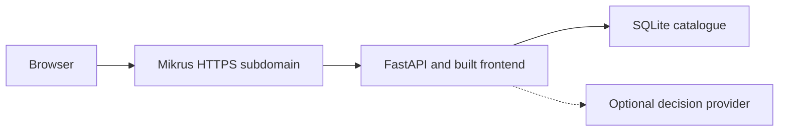

# Architecture

The release runs as one application service. A React page and the API share one origin. FastAPI owns recommendation behaviour and reads the catalogue from a local SQLite file. An optional decision provider interprets short descriptions. Music and metadata discovery run outside the live request path. Across these docs, the optional external service is the *decision provider*; choosing from the catalogue without it is *local selection*.

| Area | Agreed direction |
| --- | --- |
| Browser | React, TypeScript and Vite. Build static assets. Keep form state and a bounded list of recent album IDs in the browser. Use plain English copy. |
| Backend | Python, FastAPI and typed request and response validation. Start with one application process. Serve assets and the API together in production. |
| Data | SQLite on local persistent storage. Use versioned schema changes and catalogue snapshots or source data. Verify imports before promoting them. Treat fixture data as a separate local test input. |
| Runtime | One Docker Compose service and a persistent data volume on Mikrus 2.1. Build the image off the VPS for its architecture. Use the included HTTPS subdomain. |
| Verification | pytest, Playwright with TypeScript, one local check entry point and CI. Keep the same app contracts in local development and the release image. |

Keep public endpoints, provider interpretation and selection logic distinct enough to test. Add dependencies when they solve an observed need in the active milestone. Make dependency and implementation choices inside the agreed stack. Changes to the stack, service topology, cost ceiling or production data boundaries require a decision by the owner.

## Recommendation path

1. The browser sends the description and a small list of recent catalogue IDs to `POST /api/recommendations`.
2. The backend validates input and request limits before any provider call. Use the behaviours in [product](product.md) for what the user sees. The browser and backend apply the same input bounds.
3. With an approved provider enabled and quota available, send one bounded request for typed intent signals. Start with energy, a small set of mood or rhythm choices, and whether instrumental music is requested. Allow unknown or no preference. Validate the external response at the boundary.
4. Use a simple local interpretation when external inference is disabled, unavailable, timed out, invalid or too uncertain. The local path supports common descriptions and the explicit constraints tested for the release. The catalogue and ranking rules are the same for both paths.
5. Filter by clear requirements. Rank the remaining albums on supported attributes. Select from a small group of well-matched candidates, avoiding recent results where possible. Make selection reproducible in tests by controlling the random source. Handle a lack of eligible albums explicitly.
6. Read the title, artist, year and link from verified catalogue data. Generate the reason from known attributes and the matched intent. Provider output supplies neither factual metadata nor external links.

Use the FastAPI schema and tests to document the API contract as it grows. Distinguish invalid input, no eligible result, local unavailability and public throttling so the UI can guide recovery. Keep `/healthz` cheap and make it reflect local readiness. The health check works without contacting the model.

## Data and dependencies

- Give catalogue records stable IDs. Keep a versioned, validated real catalogue and small synthetic fixtures. Record the source and basis of facts and descriptive tags. Use parameterized queries.
- Keep secrets server-side. The browser receives just the data it needs to show one result. Keep visitor text and provider payloads out of persisted data and logs. See [operations](operations.md) for log fields and external inference controls.
- The app must start and serve recommendations with the provider disabled and absent credentials. Routine CI and the acceptance preview use local or simulated behaviour. Keep OpenCode credentials separate from runtime configuration.
- Static frontend files are packaged in the same release image. The Node toolchain runs during the build. The deployed service owns the API and static files. Use the same image for the release smoke test and production.

When the first slice lands, keep `backend/` and `frontend/` understandable at a glance. Introduce the catalogue, test and deployment files in the milestones that first use them. [FastAPI documents static file serving](https://fastapi.tiangolo.com/tutorial/static-files/) and [Docker documents multi-stage builds](https://docs.docker.com/build/building/multi-stage/).
